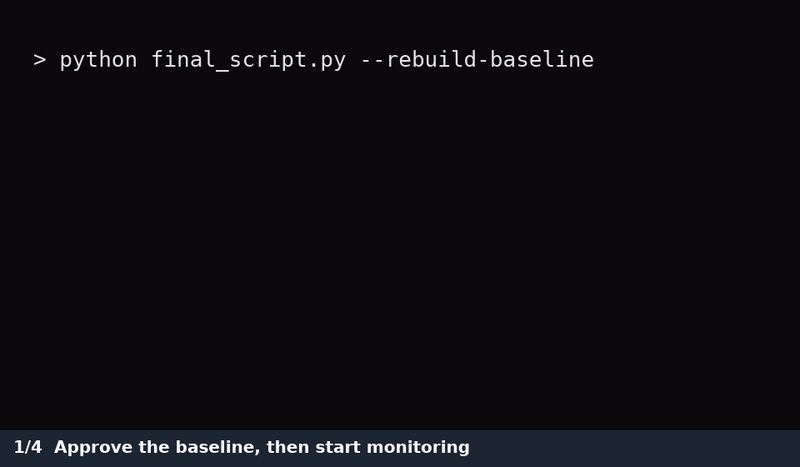

# File Integrity Monitor

A real-time file integrity monitor (FIM) written in Python. It records a SHA-256 baseline of a protected directory and raises structured alerts when files are modified, added, deleted or renamed. It also reports when a change has been reverted to the approved baseline.



## Quick start

Requires Python 3.13 and [watchdog](https://pypi.org/project/watchdog/) 6.0.0. Tested on Windows 11.

```bash
python -m pip install -r requirements.txt
python fim.py --rebuild-baseline   # approve the current state of the protected directory
python fim.py                      # start continuous monitoring (Ctrl+C to stop)
```

| Command | Purpose |
|---|---|
| `python fim.py --rebuild-baseline` | Create or replace `baseline.json` from the current files |
| `python fim.py` | Monitor continuously |
| `python fim.py --once` | Run a single scan against the baseline and exit |
| `python tamper_simulator.py` | Run a self-contained tampering demo on temporary files |

Review `config.json` and the sample files in `protected/` before building the baseline.

## Example alert

Each alert is one JSON line appended to `alerts.jsonl`:

```json
{
  "timestamp": "2026-11-08T17:01:24.496Z",
  "severity": "HIGH",
  "event_type": "CONTENT_MODIFIED",
  "rule_id": "FIM-002",
  "rule_name": "Protected file content changed",
  "source_path": "docs/policy.txt",
  "old_sha256": "9335e5543547309e60ced4ac6ceb0ff50cc7b205ef564aff5ec2ff0e1d091073",
  "new_sha256": "e9682b6833c18606c4cefbf331750ee922903cdcf8f7391f2c20e49e66fa00a8",
  "baseline_sha256": "9335e5543547309e60ced4ac6ceb0ff50cc7b205ef564aff5ec2ff0e1d091073",
  "baseline_status": "DIFFERENT",
  "baseline_id": "a38cd9101fd149559a88bf60ed820438"
}
```

`baseline_status` shows whether the file's new state matches the approved baseline. If someone undoes a change, the next alert reports `MATCH`.

## How it works

1. **Baseline.** `--rebuild-baseline` hashes every included file and writes `baseline.json` with each file's SHA-256 hash, size and timestamp, plus a baseline ID and creation time. Normal monitoring never changes the baseline, so a person must explicitly approve every new trusted state.
2. **Watch.** [watchdog](https://pypi.org/project/watchdog/) reports directory activity. Bursts of events are debounced, then the affected files are hashed in chunks so large files aren't loaded into memory.
3. **Reconcile.** A periodic full rescan catches anything the event stream missed and confirms that changes have persisted.
4. **Alert.** Each difference is matched to a configurable detection rule and written to `alerts.jsonl`.

## Capabilities

| # | Capability | Details |
|---|---|---|
| 1 | Configurable protection scope | Set the protected directory and exclusion patterns in `config.json`. Relative paths are resolved against the config file's folder. |
| 2 | Baseline manifest | Records approved file hashes, sizes and timestamps with a baseline ID and creation time. |
| 3 | Recursive file discovery | Scans nested directories and skips symbolic links, junctions and excluded paths. |
| 4 | SHA-256 hashing | Reads files in configurable chunks instead of loading whole files into memory. |
| 5 | Explicit baseline approval | Only `--rebuild-baseline` creates or replaces `baseline.json`. |
| 6 | Continuous monitoring | Watches directory activity with watchdog and checks file contents while running. |
| 7 | Event reconciliation | Debounces closely spaced events and rescans at a configured interval. |
| 8 | Content modification detection | Detects hash changes, even when an edit keeps the file's size and modification time. |
| 9 | File addition detection | Detects new included files anywhere in the protected tree. |
| 10 | File deletion detection | Detects removed files. A rename produces a deletion plus an addition. |
| 11 | Restoration tracking | Reports whether each new state matches the baseline and suppresses repeated identical findings. |
| 12 | External detection rules | Rule IDs, names and severities for each event type are set in config. All rules default to HIGH. |
| 13 | Structured alert logging | Writes JSON Lines alerts with UTC timestamps, hashes, rule info and baseline status. |
| 14 | Validation and read recovery | Rejects invalid config or baseline files. Defers locked or still-changing files to a later scan. |
| 15 | Controlled tamper simulation | Runs a modification, addition, deletion and rename on temporary files, then checks for the five expected alerts. |

## Detection rules

| Rule | Event | Default severity |
|---|---|---|
| FIM-001 | `FILE_ADDED` | HIGH |
| FIM-002 | `CONTENT_MODIFIED` | HIGH |
| FIM-003 | `FILE_DELETED` | HIGH |

## Project structure

```
.
├── fim.py                 # monitor
├── tamper_simulator.py    # self-contained tampering demo
├── config.json            # protected path, exclusions, timing, rules
├── requirements.txt
└── protected/             # sample files to monitor
```

`baseline.json` and `alerts.jsonl` are created when the monitor runs and are not committed to the repo.

## Limitations

- The monitor compares observed file states, so it can miss a change that is reversed between two scans.
- Alerts show that a file's integrity changed. They don't establish malicious intent or identify which process made the change.
- An attacker with write access could tamper with the baseline, config and alert log. Protect them with operating system permissions.
